<a href="https://github.com/Tanmai-Thakre">
  
</a>

  
  
  
  
  




<!-- Project 1: KisanSetu AI -->
<a href="https://github.com/Tanmai-Thakre/Kisansetu-ai"></a>

  
  

<!-- Project 2: RL DQN Flappy Bird -->
<a href="https://github.com/Tanmai-Thakre/RL_DQN_FlappyBird"></a>

  
  

<!-- Project 3: Intelligent Systems Suite -->
<a href="https://github.com/Tanmai-Thakre/Minor_Projects"></a>

  
  




  
  

  


  
  
  
  
  

